# Sales Data Analysis using SQL

SQL analysis of a sales dataset using **PostgreSQL**. The project answers 18 business questions using filtering, sorting, aggregate functions, DISTINCT and GROUP BY, and turns each result into a short insight.

## Dataset

- **Table:** `orders_data` (100 rows)
- **Columns:** order_id, order_date, ship_date, customer_name, region, city, category, product_id, sales, quantity, profit
- **Regions:** Central, East, South, West
- **Categories:** Furniture, Office Supplies, Technology
- **Period:** May 2018 to December 2021

## Tools

PostgreSQL 18, pgAdmin 4

## Data Cleaning

The data had been loaded twice by mistake (200 rows instead of 100), which doubled every total. I removed the duplicates with:

```sql
DELETE FROM orders_data a
USING orders_data b
WHERE a.ctid < b.ctid
  AND a.order_id = b.order_id
  AND a.product_id = b.product_id;
```

All results below are based on the cleaned 100-row table. All queries are in [`sales_queries_4.sql`](sales_queries_4.sql).

---

## Q1. Dataset preview: what are the customer, region, city and category of each order?

```sql
SELECT customer_name, region, city, category
FROM orders_data
LIMIT 5;
```

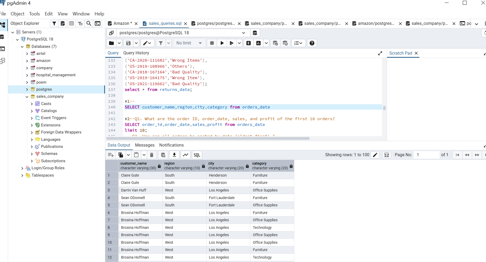

**Insight:** The dataset has customer, region, city and category details for each order.

---

## Q2. What are the order ID, order date, sales and profit of the first 10 orders?

```sql
SELECT order_id, order_date, sales, profit
FROM orders_data
LIMIT 10;
```

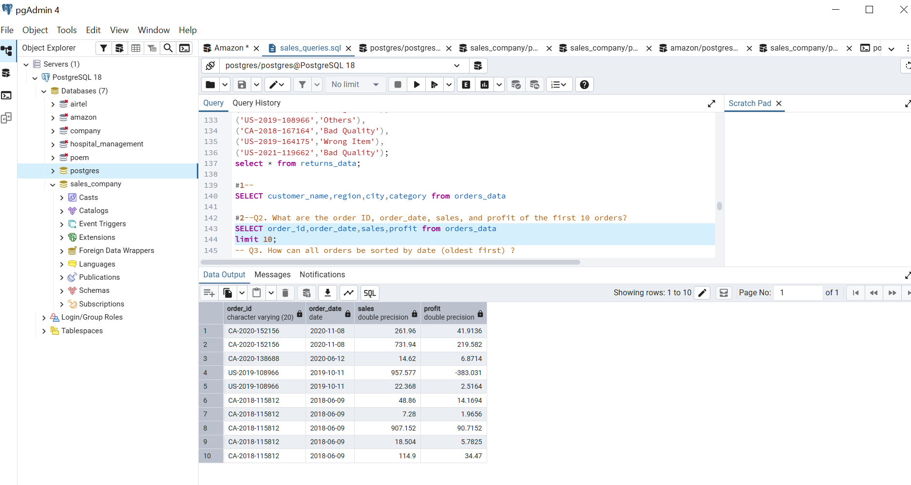

**Insight:** Sales in the first 10 orders range from 7.28 to 957.58. Order US-2019-108966 has the highest sales but a loss of about 383.

---

## Q3. How can all orders be sorted by date (oldest first)?

```sql
SELECT order_id, order_date, sales, profit
FROM orders_data
ORDER BY order_date, profit DESC;
```

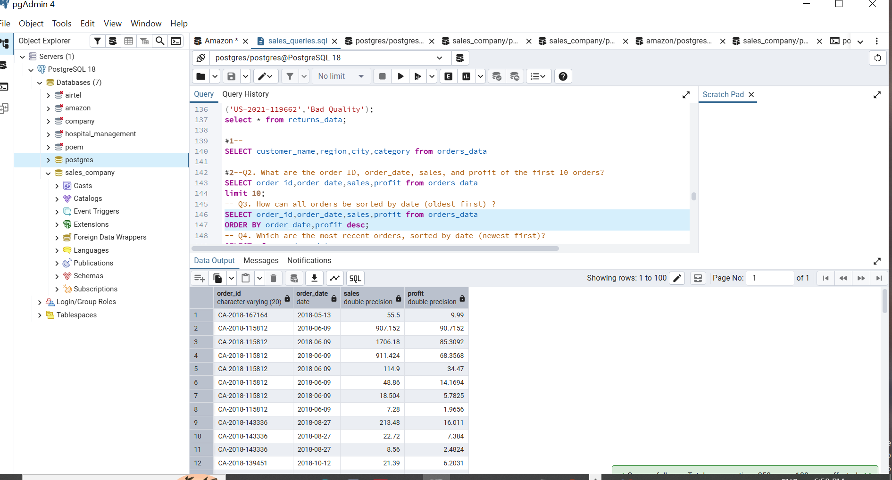

**Insight:** The oldest order is CA-2018-167164 from 13 May 2018 (sales 55.50, profit 9.99).

---

## Q4. Which are the most recent orders, sorted by date (newest first)?

```sql
SELECT *
FROM orders_data
ORDER BY order_date DESC;
```


**Insight:** The most recent orders are from 9 Dec 2021 (Ken Brennan, Houston, Central region).

---

## Q5. Which are the top 5 orders by sales?

```sql
SELECT *
FROM orders_data
ORDER BY sales DESC
LIMIT 5;
```

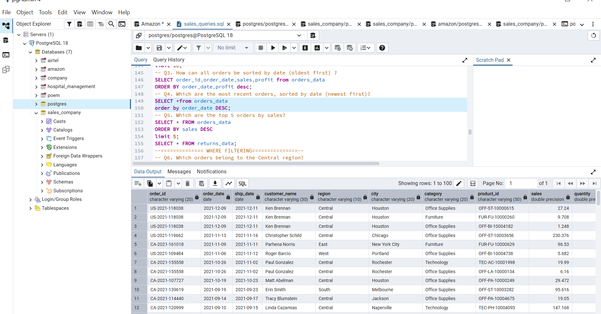

**Insight:** The top sale is 3,083.43 (Furniture, Tracy Blumstein), but that order made a loss of about 1,665. High sales do not always mean profit.

---

## Q6. Which orders belong to the Central region?

```sql
SELECT *
FROM orders_data
WHERE region = 'Central';
```

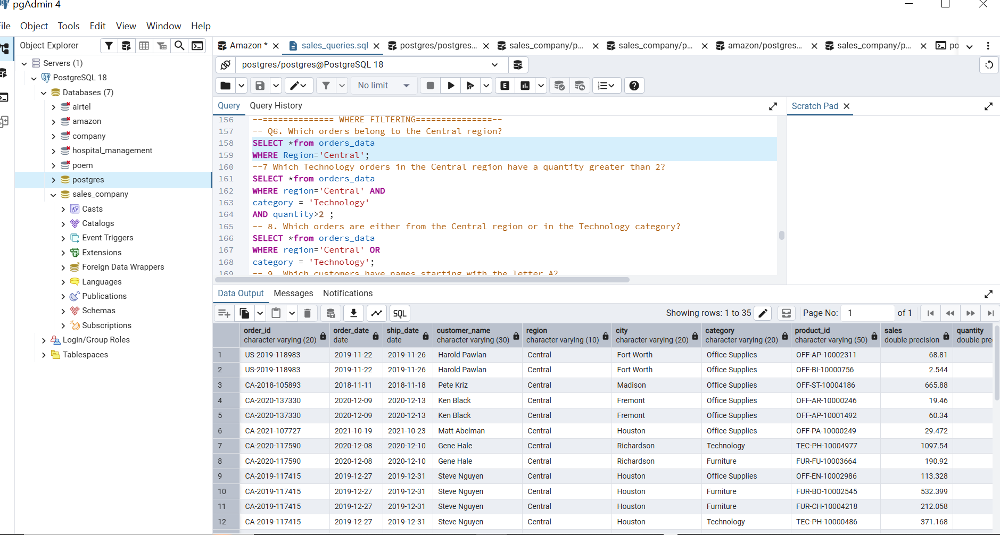

**Insight:** 35 of 100 orders (35%) are from the Central region, the highest of any region.

---

## Q7. Which Technology orders in the Central region have a quantity greater than 2?

```sql
SELECT *
FROM orders_data
WHERE region = 'Central'
  AND category = 'Technology'
  AND quantity > 2;
```

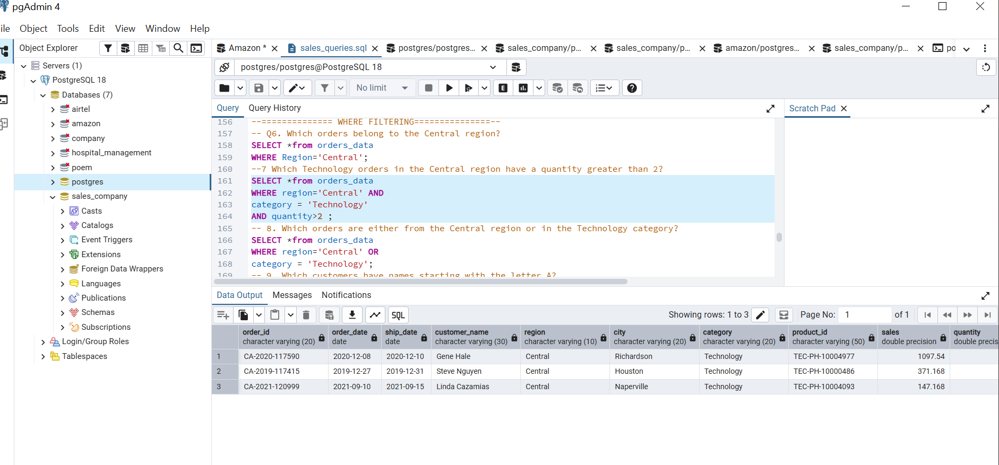

**Insight:** Only 3 orders qualify. The largest is 1,097.54 (Gene Hale, Richardson).

---

## Q8. Which orders are either from the Central region or in the Technology category?

```sql
SELECT *
FROM orders_data
WHERE region = 'Central'
   OR category = 'Technology';
```

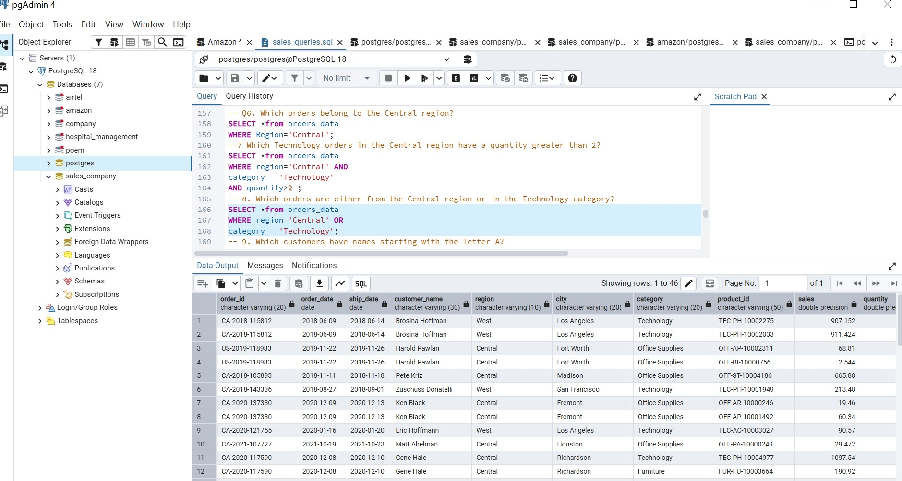

**Insight:** 46 of 100 rows are either Central or Technology.

---

## Q9. Which customers have names starting with the letter A?

```sql
SELECT *
FROM orders_data
WHERE customer_name LIKE 'A%';
```

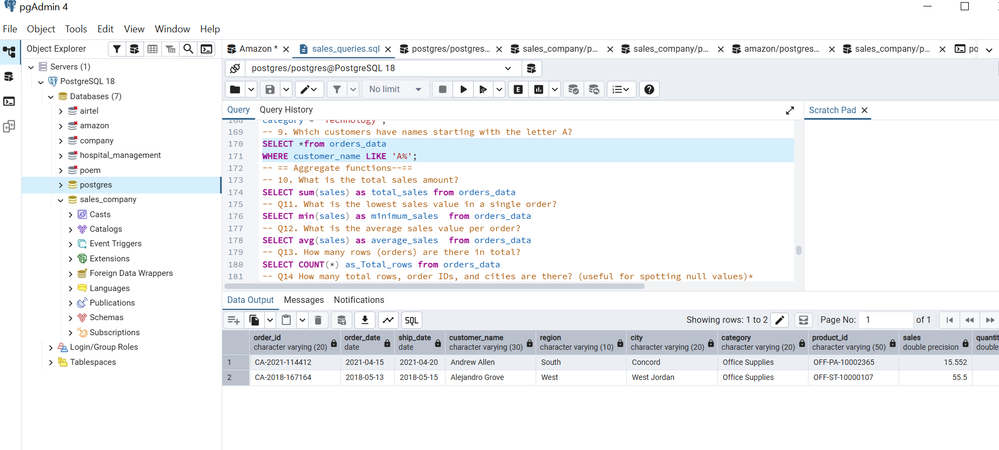

**Insight:** Only Andrew Allen (South) and Alejandro Grove (West) match, one order each, both Office Supplies.

---

## Q10. What is the total sales amount?

```sql
SELECT SUM(sales) AS total_sales
FROM orders_data;
```

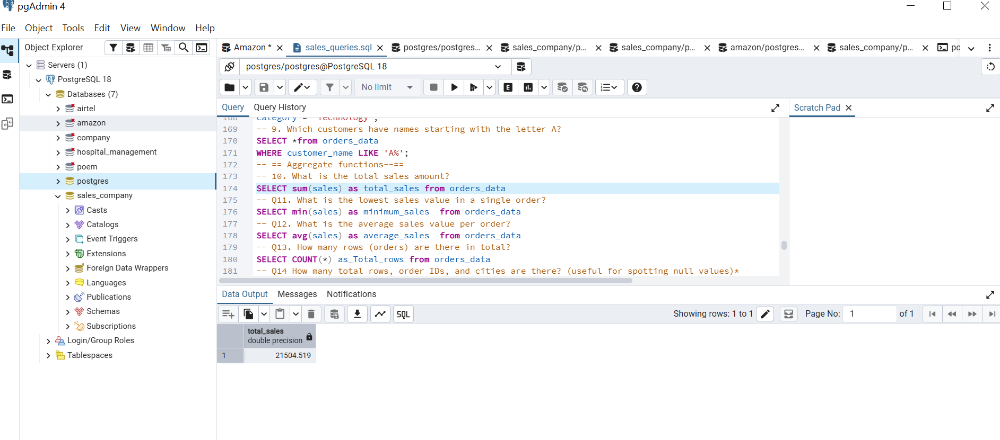

**Insight:** Total sales are about 21,504.52.

---

## Q11. What is the lowest sales value in a single order?

```sql
SELECT MIN(sales) AS minimum_sales
FROM orders_data;
```


**Insight:** The lowest sales value in a single order is 1.248.

---

## Q12. What is the average sales value per order?

```sql
SELECT AVG(sales) AS average_sales
FROM orders_data;
```

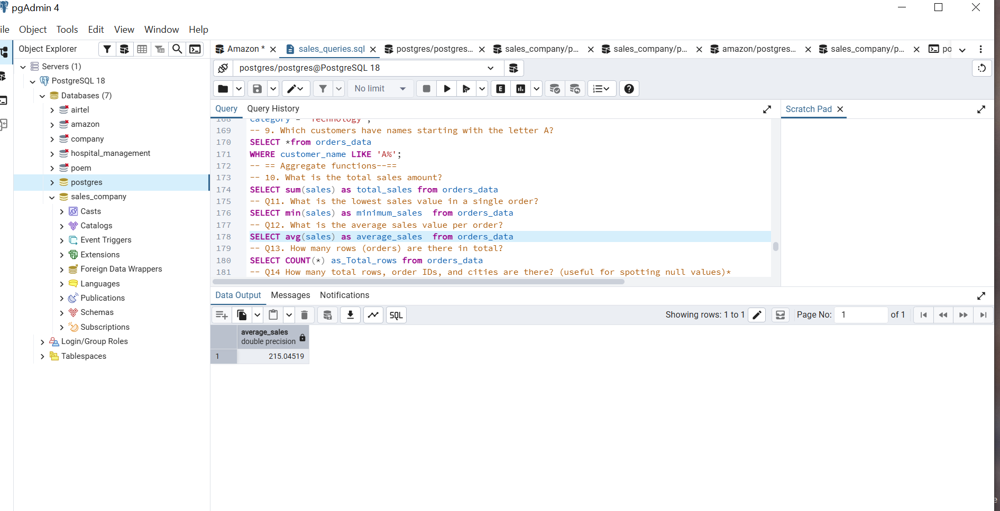

**Insight:** Average sales per order is about 215.05.

---

## Q13. How many rows (orders) are there in total?

```sql
SELECT COUNT(*) AS total_rows
FROM orders_data;
```

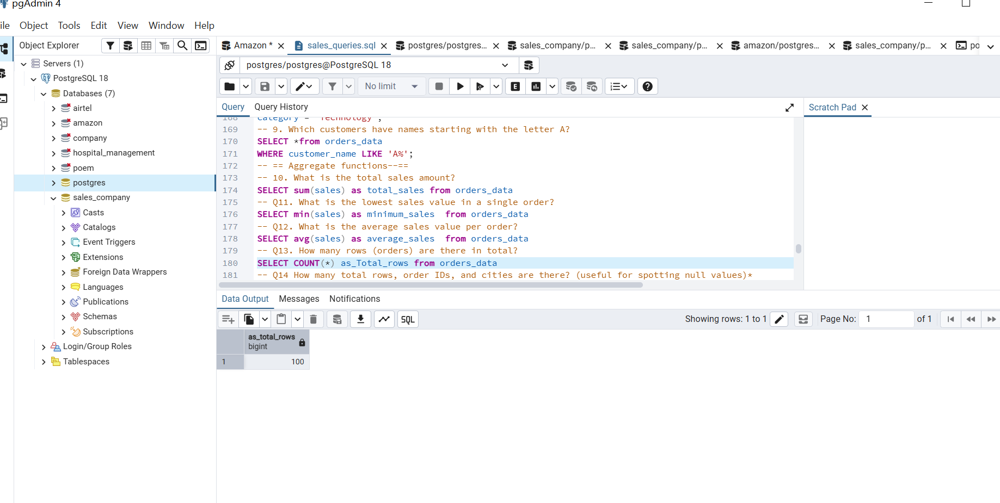

**Insight:** The table has 100 rows.

---

## Q14. How many total rows, order IDs and cities are there? (useful for spotting null values)

```sql
SELECT COUNT(*),
       COUNT(order_id) AS total_id,
       COUNT(city) AS total_records
FROM orders_data;
```

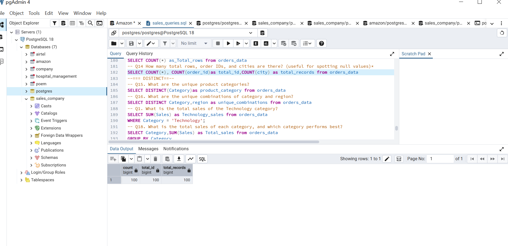

**Insight:** All three counts are 100, so there are no missing values in these columns.

---

## Q15. What are the unique product categories?

```sql
SELECT DISTINCT(category) AS product_category
FROM orders_data;
```

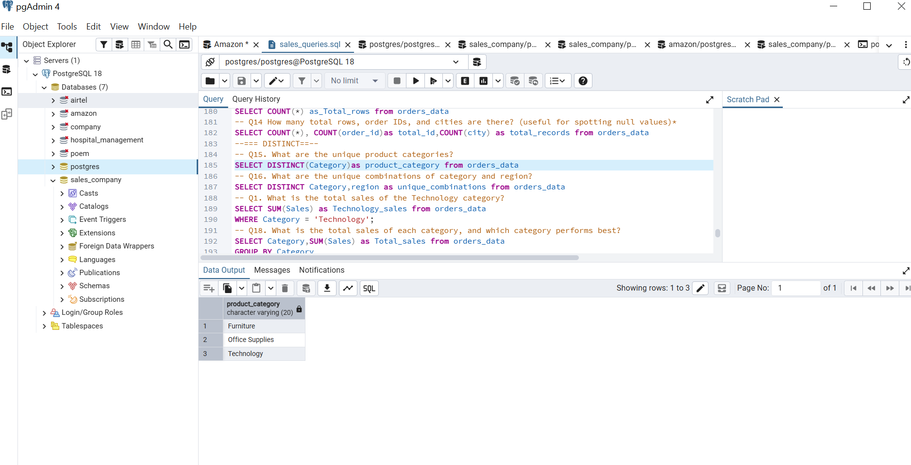

**Insight:** There are three categories: Furniture, Office Supplies and Technology.

---

## Q16. What are the unique combinations of category and region?

```sql
SELECT DISTINCT category, region AS unique_combinations
FROM orders_data;
```

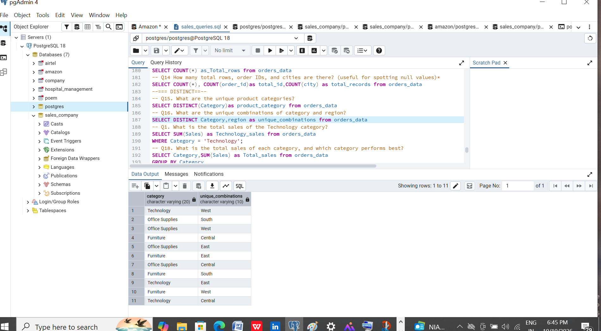

**Insight:** 11 of 12 combinations exist. Technology has no orders in the South.

---

## Q17. What is the total sales of the Technology category?

```sql
SELECT SUM(sales) AS technology_sales
FROM orders_data
WHERE category = 'Technology';
```

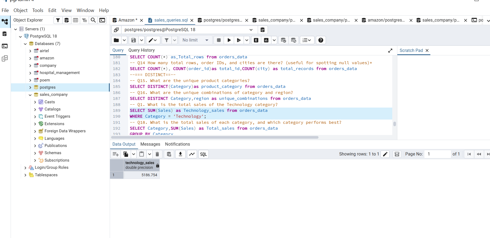

**Insight:** Technology sales are about 5,186.75, around 24% of total sales.

---

## Q18. What is the total sales of each category, and which category performs best?

```sql
SELECT category, SUM(sales) AS total_sales
FROM orders_data
GROUP BY category
ORDER BY total_sales DESC;
```

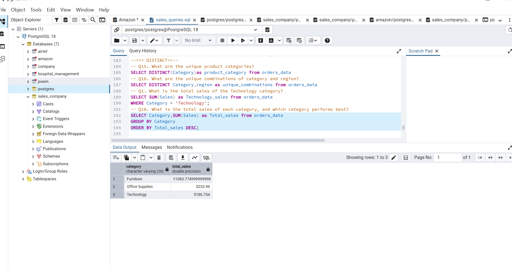

**Insight:** Furniture leads with 11,083.78 (about 52% of sales). Office Supplies (5,233.99) and Technology (5,186.75) are about 24% each.

---

## Key Findings

- Furniture brings in about half of all sales (52%), even though Office Supplies has more orders.
- The Central region has the most orders (35 of 100).
- The biggest single sale (3,083.43) made a large loss, so sales and profit need to be checked together.
- Technology has no orders in the South region.

## SQL Skills Used

SELECT, WHERE, AND / OR, LIKE, ORDER BY, LIMIT, DISTINCT, SUM, AVG, MIN, COUNT, GROUP BY, data cleaning with DELETE.
